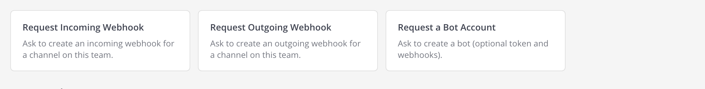
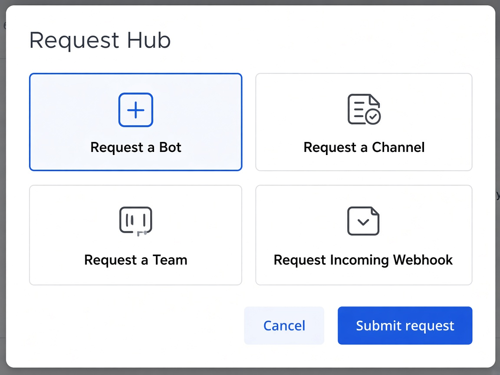
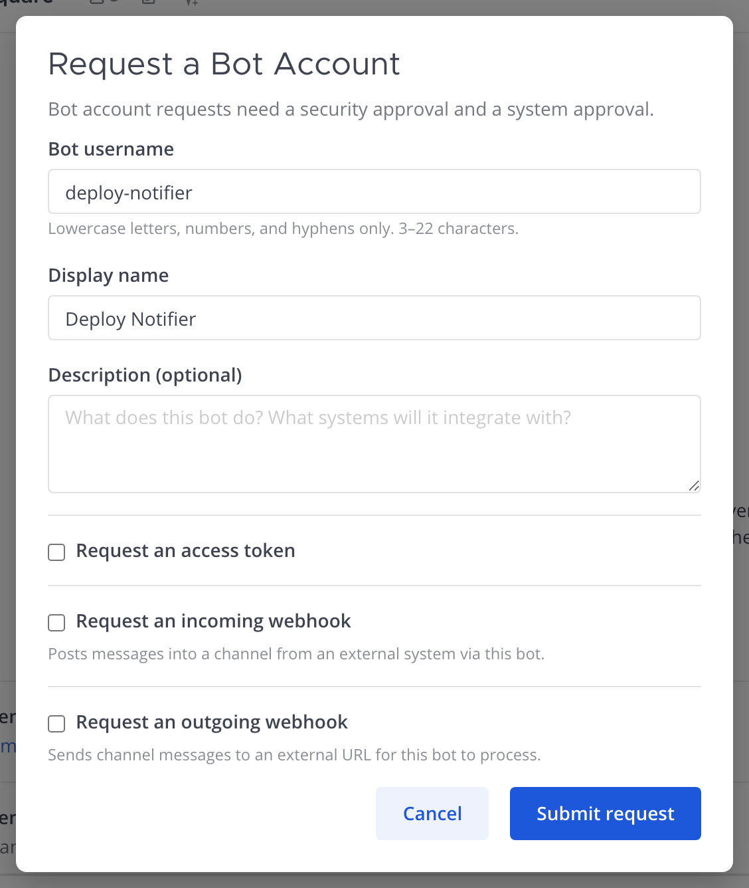
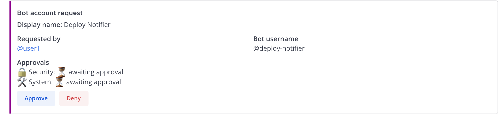
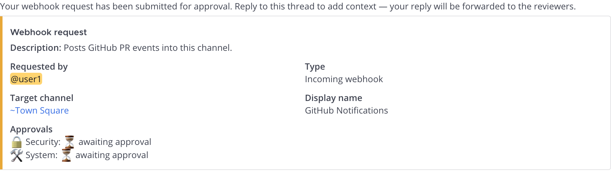

# Bot Account Requests: User Guide

Mattermost Request Hub lets members **request a bot account** (optionally
with an access token and incoming/outgoing webhooks in the same ticket) instead
of creating bots directly. Bot requests use **two-step approval** (security +
system). On final approval the bot is created and secrets are delivered by DM
(the DM auto-deletes after 72 hours).

> If you only need a webhook and already have a bot (or don't need one), use the
> [standalone webhook guide](WEBHOOK_REQUEST_GUIDE.md) instead.
>
> Companion guides: [new channels](CHANNEL_CREATION_GUIDE.md) ·
> [Channel Admin](CHANNEL_ADMIN_GUIDE.md) · [teams](TEAM_REQUEST_GUIDE.md) ·
> [webhooks](WEBHOOK_REQUEST_GUIDE.md).
>
> In Mattermost: **`/mattermost-request-hub docs`** opens the full HTML guide.

This guide covers:

- [Requesting a bot](#requesting-a-bot): any member
- [Messaging while a request is pending](#messaging-while-a-request-is-pending): two-way threads
- [Approving requests](#approving-requests): security + system approvers
- [Admin setup](#admin-setup): system admins

---

## Requesting a bot

Same **Request a Bot Account** form from every entry point.

### How to open

- **Native:** Main Menu → Integrations → **Bot Accounts** (non–System Admins; System Admins still get native bot management)
- **Dropdown:** channel More actions → **Request a Bot**
- **Hub:** right App Bar **plug** → Requests → **Request a Bot**
- **Slash:** `/mattermost-request-hub bot` (or skip the form with
  `/mattermost-request-hub bot <username> <Display name> [--description <text>] [--owner @user]`;
  access tokens and webhooks for the bot are only in the form)
- **Agent:** when **Offer tools to Agents** is on, ask an agent from the
  Mattermost Agents plugin to file it for you (the `request_bot` tool, which like the
  slash command covers the account only; see the
  [admin guide](admin-guide.md#agents-tools))

### Form

#### Required fields

| Field | What it does |
|-------|--------------|
| **Bot username** | Username the bot posts as. Lowercase letters, numbers, periods, underscores, and hyphens. 3–22 characters. Example: `deploy_bot` or `deploy-notifier`. |
| **Display name** | Friendly name shown in messages. Example: `Deploy Notifier`. |
| **Description** | Optional. What the bot does and which systems it connects to. |

#### Optional: Access token

**Request an access token** is checked by default. External systems use this
token to authenticate to Mattermost as the bot.

> The token is sent in a DM when the request is fully approved. That DM
> **auto-deletes after 72 hours**. Save the token in a secrets manager or CI
> vault before it disappears. The token itself does not expire until you revoke it.

Uncheck this if the bot only receives messages via an incoming webhook and never
calls the API.

#### Optional: Incoming webhook

Check **Request an incoming webhook** to also create a webhook that posts
*into* Mattermost on behalf of this bot.

| Field | What it does |
|-------|--------------|
| **Webhook display name** | Pre-filled with `{username} incoming`. Edit if needed. |
| **Target channel** | Pre-filled with the channel you're currently in (read-only). Switch channels before opening the form to change it. |

#### Optional: Outgoing webhook

Check **Request an outgoing webhook** to forward messages from a channel to an
external URL (for example, to trigger a pipeline on a keyword).

| Field | What it does |
|-------|--------------|
| **Webhook display name** | Pre-filled with `{username} outgoing`. |
| **Source channel** | Pre-filled with your current channel (read-only). |
| **Callback URL** | Required. The `https://` endpoint that receives the payload. |

### Submitting

Click **Submit request**. One approval ticket covers the bot, token, and any
webhooks you checked. You'll get a DM when both approvers have acted.

---

## Messaging while a request is pending

Bot tickets use the same **two-way thread relay** as other request types.
Open the **Thread** RHS from the card (Reply / reply count), not a new root post.

- **Approver:** ask in the approval Thread (e.g. *What systems will this bot call?*)
- **Requester:** see `Message from @admin:` in your DM Thread with the bot
- **Reply:** answer in that DM Thread; the approval Thread shows `Reply from @you:`

Reply inside the ticket Thread only. A brand-new DM to the bot gets a nudge to
use the specific request thread. Threads remain open after approve/deny (useful
if a token DM needs follow-up).

---

## Approving requests

Bot requests post to **`mattermost-bot-requests`**. They need **two different
people**: one security-step approver and one system-step approver. The card shows
both status lines.

Each eligible approver clicks **Approve** once for their step. When both steps
are complete, the plugin:

1. Creates the bot account.
2. Generates an access token if requested.
3. Creates any requested incoming/outgoing webhooks.
4. DMs the requester with results (tokens/URLs auto-delete after 72 hours).

Any eligible approver may **Deny** at any time. That closes the ticket and
notifies the requester.

### DM to the requester

The DM includes:

- Bot account confirmation
- Access token (if requested): **message auto-deletes in 72 hours**
- Incoming webhook URL (if requested)
- Outgoing webhook confirmation (if requested)

If something failed, the DM says what couldn't be created and what to do next.

Every bot request goes through both approval steps, including requests from
System Admins. Nobody can approve either step of their own request, so a System
Admin's request needs a security approver and a different system approver (or
one other System Admin when the approver mode is System Admins only).

---

## Admin setup

| Setting | Purpose |
|---------|---------|
| **Approval team** | Owns `mattermost-bot-requests`. Required. |
| **Allow bot account requests** | Enables bot entry points. Default **on**. |
| **Security approver attribute** | User Attribute (access_control) for the security step. System Admins do **not** auto-qualify. |
| **System approver attribute** | User Attribute for the system step. System Admins auto-qualify. |

Create and assign attributes in **System Console → User Management → Attributes**.
See the [Admin Guide](admin-guide.md).

### Token security

Tokens are delivered by DM and not stored by the plugin. If a token is
compromised, rotate it under **System Console → User Management → Bot Accounts**
and revoke the old one.
