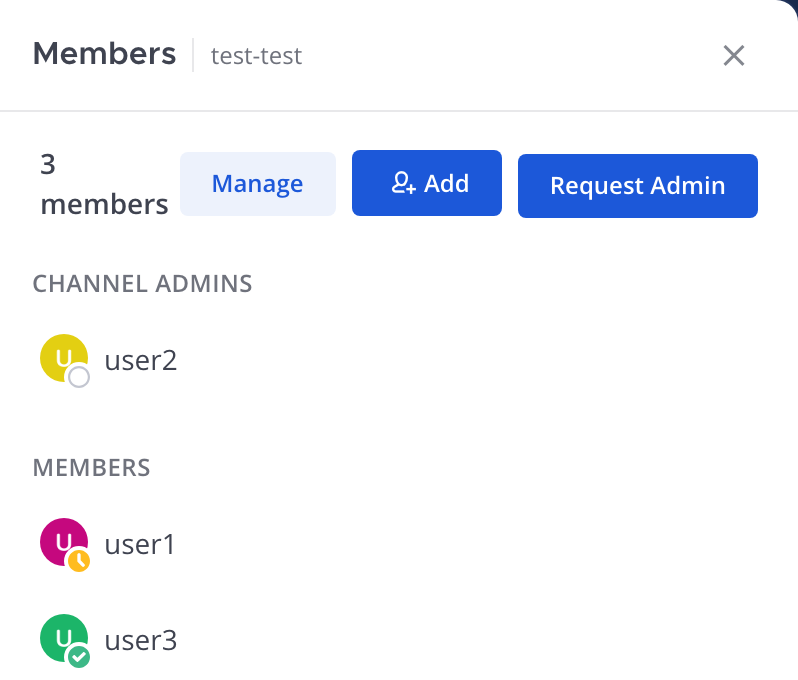
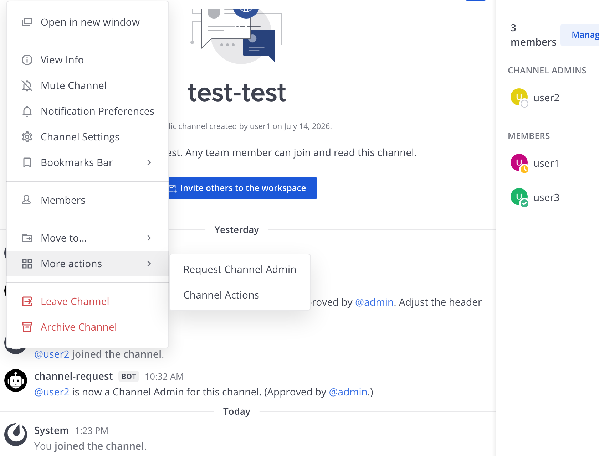
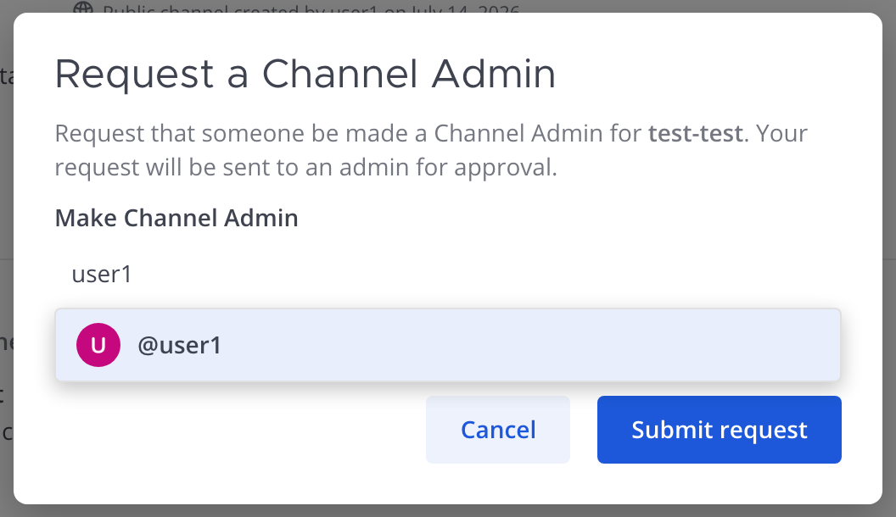
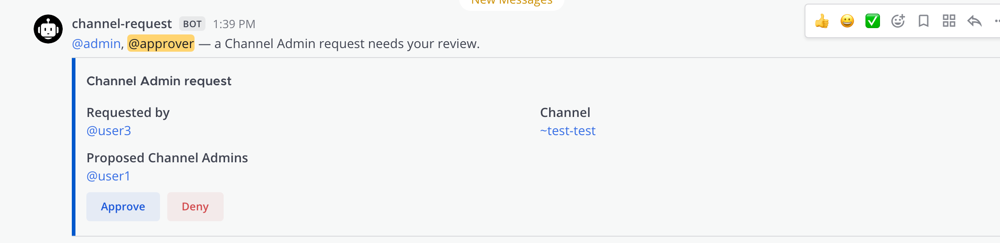

# Channel Admin Requests — User Guide

The Channel Requests plugin also lets a member **request that someone be made a
Channel Admin** on a channel that already exists — without giving every member
the ability to manage the channel directly. The request goes to an approver;
on approval the nominee is granted the Channel Admin role. Nominees must already
be members of the channel — this flow never adds anyone to a channel.

> This is the companion to [creating channels](CHANNEL_CREATION_GUIDE.md). *That* guide is
> about requesting a **new** channel; *this* one is about requesting **admin
> rights on an existing** channel.

This guide covers three roles:

- [Requesting a Channel Admin](#requesting-a-channel-admin) — any non-admin member
- [Approving requests](#approving-requests) — approvers
- [Admin setup](#admin-setup) — system admins

---

## Requesting a Channel Admin

There are two ways to open the request form, and both open the same window. The
option is **only shown to members who aren't already an admin** of the channel —
if you're already a Channel Admin (or a System Admin), you can manage the channel
directly and won't see it. You can also skip the form and use the
[slash command](#3-from-the-slash-command).

### 1. From the Members panel

Open the channel's **Members** list (click the member count in the channel
header). Next to **Add** you'll see a **Request Admin** button.



### 2. From the channel-name menu

Click the channel name at the top-left, then **More actions → Request Channel
Admin**. (Same form as the Members-panel button — use whichever is handier.)



### 3. From the slash command

In the channel itself, type:

```
/channel-request admin @user [@user ...]
```

It asks for everyone you name to be made a Channel Admin of that channel, with
the same rules and approval as the form. The command isn't hidden from people who
are already admins, but they can manage the channel directly instead.

### 4. Through an AI agent

If a System Admin has turned on **Offer tools to Agents**, you can ask an agent
from the Mattermost Agents plugin to request it for you, naming the channel and
the people. It uses the `request_channel_admin` tool and acts as you, with the
same rules and approval as the form: you must be a member of the channel, and so
must everyone you nominate.

### Filling out the request



| Field | What it does |
|-------|--------------|
| **Make Channel Admin** | Search and add one or more people to be promoted to Channel Admin. Start typing a name and pick from the list. |

Everyone you add is promoted to Channel Admin once an approver accepts the
request. Everyone you nominate must already be a member of the channel; if
someone isn't, add them to the channel first (or ask a Channel Admin to).

Click **Submit request**. You'll see a confirmation, and you'll get a direct
message when an approver responds.

**Limits.** A System Admin sets how many Channel Admin requests you can have
waiting for review at once. At the limit you'll see *you have N pending requests
waiting for review; you can submit more once some are approved, denied or
expire*. Asking again for the same people in the same channel while that request
is pending shows *you already have a pending Channel Admin request for these
people in this channel*. Requests that aren't reviewed within the configured
number of days expire, and you'll get a direct message saying so.

---

## Approving requests

The request is posted to the **approval channel**, and everyone who can act on it
is @-mentioned there: every **System Admin** plus the **Team Admins** of the
channel's team (bot and deactivated accounts aren't mentioned). Any of them can **Approve** or **Deny** — except that only a
System Admin can approve a request they made themselves. Team Admins of other
teams, including the approval team, can't act on it.



- **Approve** — each nominee who is still a member of the channel is promoted to
  Channel Admin. Anyone who has left since the request was made is skipped, and
  the approval message, DM and audit line list only who was actually promoted.
  A bot message in the channel announces who can now manage it.
- **Deny** — the request is closed and the requester is notified by DM.

Approve checks the request again first. If the requester's account is no longer
active, or they've left the channel (System Admins excepted), you'll get a
private message saying so (for example *The requester is no longer a member of
the channel. Deny this request instead.*). The request stays pending and the
card keeps its buttons, so deny it. If the requester can't be checked at that
moment, you'll see *Could not check the requester right now. Try again in a
moment.* instead.

A request that wasn't reviewed within **Request expiry (days)** can't be
approved: clicking either button replies *This request has expired.*, marks the
card *⌛ Expired: not reviewed within N days.* and DMs the requester.

Requests from **System Admins** and users on the **auto-approve list** skip this
step — the nominees are promoted immediately.

---

## Admin setup

Channel Admin requests reuse the same approval settings as channel-creation
requests, in **System Console → Plugins → Channel Requests**:

| Setting | Purpose |
|---------|---------|
| **Approval team** | The team that owns the approval channel. Recommended. |
| **Approval channel** | The channel where Channel Admin request cards are posted. Recommended: if it isn't set, or the channel is missing or archived, each request is sent by direct message to every System Admin instead. |
| **Team Admins can approve requests** | Applies to channel-creation requests only. Channel Admin requests are always reviewed by System Admins and the Team Admins of the *requested channel's* team, whatever this is set to. |
| **Auto-approve requests from these users** | Requests from these users skip approval — nominees are promoted immediately. |
| **Pending requests per user** | How many Channel Admin requests one user can have waiting for review (counted separately from channel requests), up to `1000`. Default `5`; `0` means no limit. |
| **Request expiry (days)** | Pending requests older than this can no longer be approved. At most `3650`. Default `30`; `0` means requests never expire. |

See the [channel-creation guide](CHANNEL_CREATION_GUIDE.md#admin-setup) for the full settings
reference.
