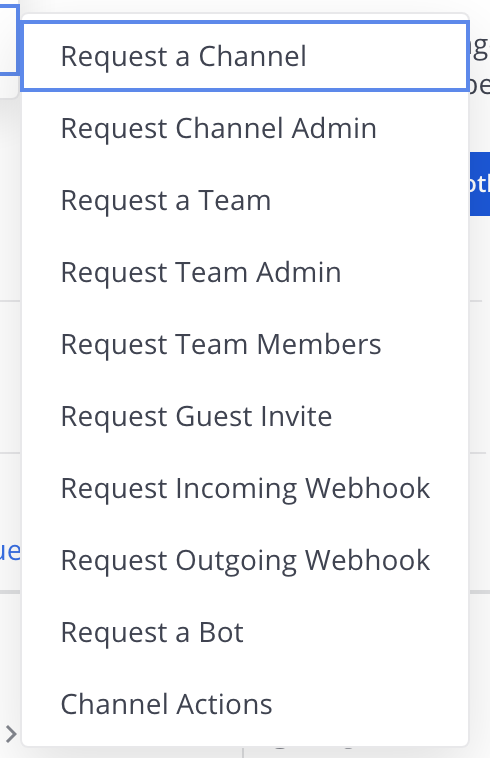
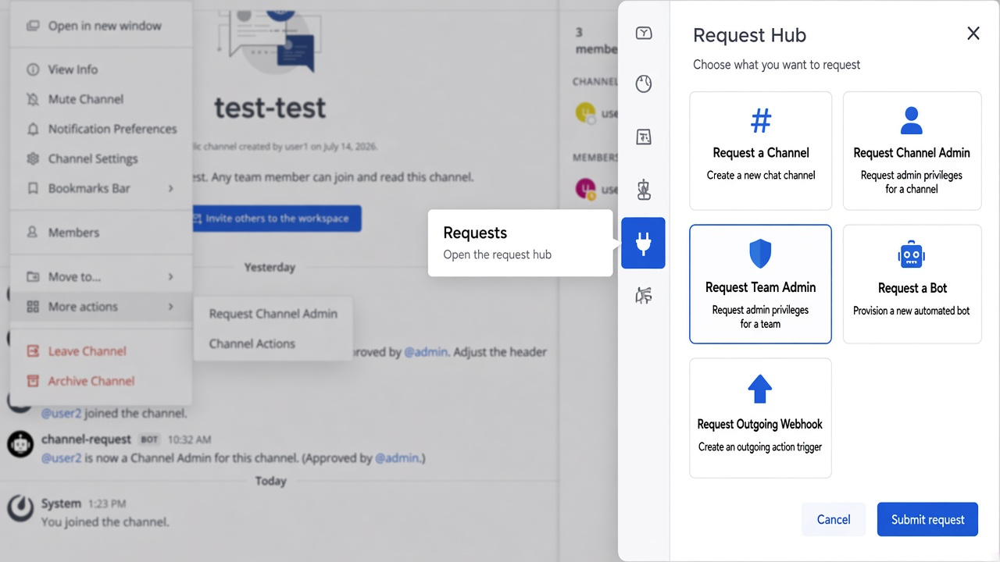
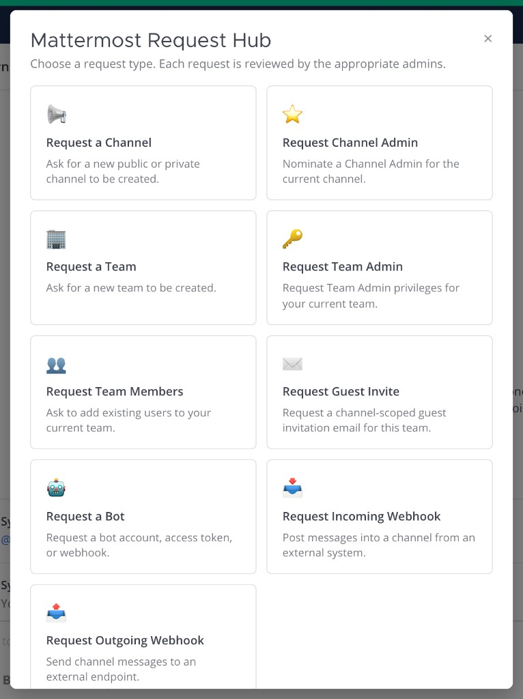
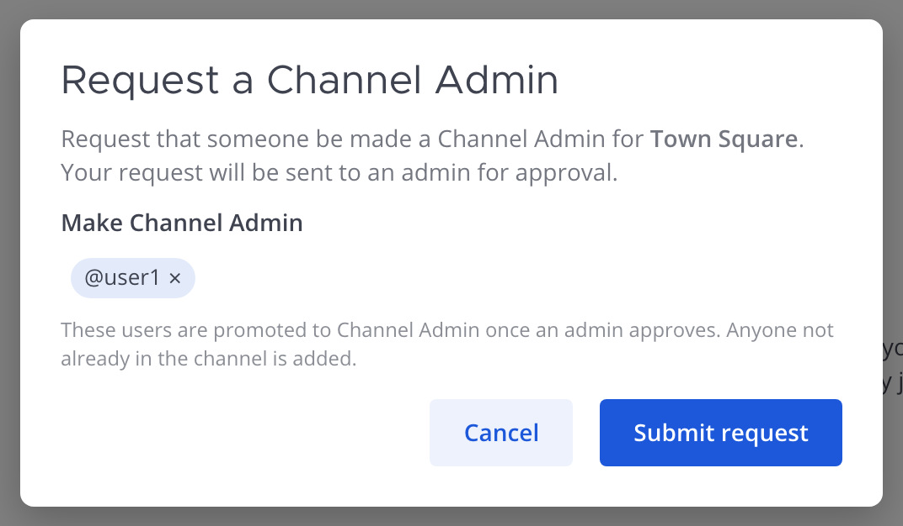
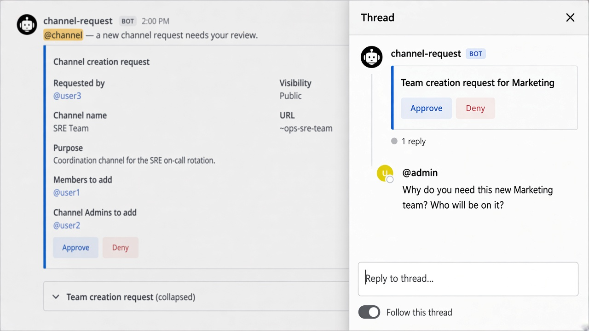
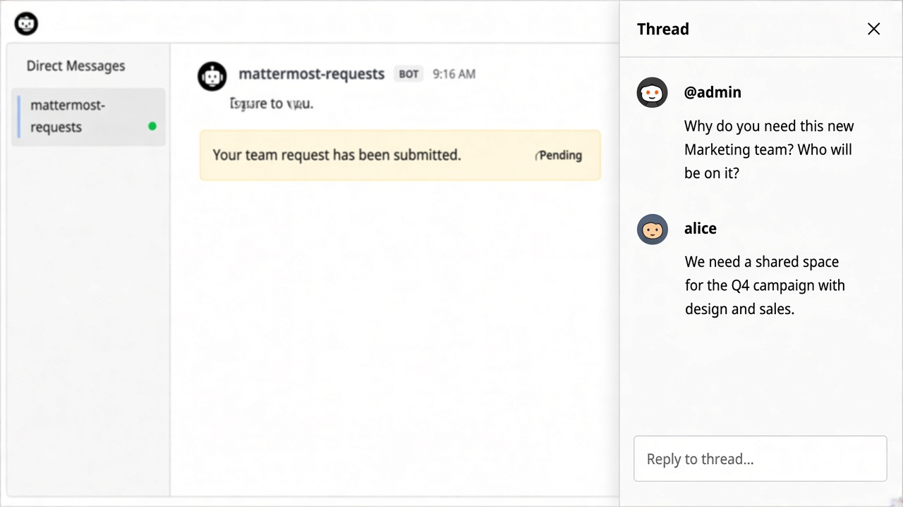
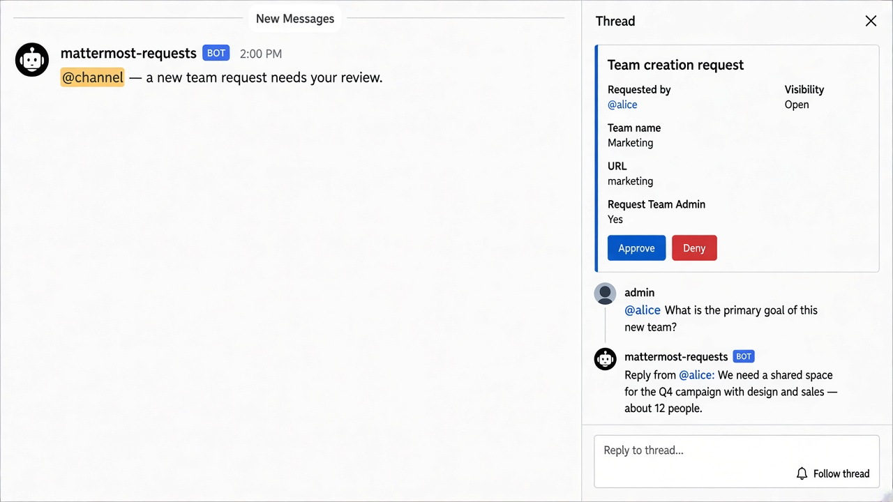
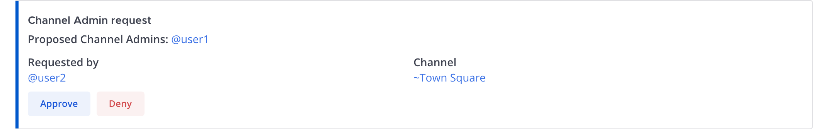

# Channel Admin Requests: User Guide

Mattermost Request Hub also lets a member **request that someone be made a
Channel Admin** on a channel that already exists, without giving every member
the ability to manage the channel directly. The request goes to an approver;
on approval the nominee is granted the Channel Admin role. Nominees must already
be members of the channel: this flow never adds anyone to a channel.

> Companion guides: [new channels](CHANNEL_CREATION_GUIDE.md) ·
> [teams](TEAM_REQUEST_GUIDE.md) ·
> [team membership & guests](TEAM_MEMBERSHIP_GUIDE.md) ·
> [bots](BOT_REQUEST_GUIDE.md) · [webhooks](WEBHOOK_REQUEST_GUIDE.md) ·
> [Admin Guide](admin-guide.md).
>
> In Mattermost, open the full in-app guide anytime with
> **`/mattermost-request-hub docs`**. It is served by the plugin at
> `/plugins/com.mattermostfederal.mattermost-plugin-request-hub/public/help/docs.html`,
> with a full slash command reference (`slash.html`) and a troubleshooting page
> (`troubleshooting.html`).

This guide covers:

- [Requesting a Channel Admin](#requesting-a-channel-admin): any non-admin member
- [Messaging while a request is pending](#messaging-while-a-request-is-pending): two-way threads
- [Approving requests](#approving-requests): approvers
- [Admin setup](#admin-setup): system admins

---

## Requesting a Channel Admin

Same form from every entry point. The option is **only shown to members who
aren't already an admin** of the channel. If you're already a Channel Admin
(or a System Admin), you can manage the channel directly and won't see the menu
items (the slash command still works if the feature is enabled).

### How to open

- **Members:** channel Members panel → **Request Admin**
- **Dropdown:** channel name → More actions → **Request Channel Admin**
- **Hub:** right App Bar **plug** → Requests → **Request Channel Admin**
- **Slash:** `/mattermost-request-hub channel-admin` (or skip the form, see
  [From the slash command](#from-the-slash-command))

<p>




</p>

> Tip: **`/mattermost-request-hub docs`** opens the full documentation page.

### From the slash command

`/mattermost-request-hub channel-admin` on its own opens the form. To skip it,
run this in the channel itself:

```
/mattermost-request-hub channel-admin @user [@user ...]
```

It asks for everyone you name to be made a Channel Admin of that channel, with
the same rules and approvers as the form: you must be a member of the channel
(System Admins excepted), and so must everyone you name. Replies are only
visible to you. If Channel Admin requests are turned off, the command says so.

### Through an AI agent

If a System Admin has turned on **Offer tools to Agents**, you can ask an agent
from the Mattermost Agents plugin to request it for you, naming the channel and
the people. It uses the `request_channel_admin` tool and acts as you, with the
same rules and approvers as the form: you must be a member of the channel
(System Admins excepted), and so must everyone you nominate. If Channel Admin
requests are turned off, the agent is told so. As with the form, a System
Admin's request goes to the approvers too.

### Form



| Field | What it does |
|-------|--------------|
| **Make Channel Admin** | Search and add one or more people to be promoted to Channel Admin. Start typing a name and pick from the list. |

Everyone you add is promoted to Channel Admin once an approver accepts the
request. Everyone you nominate must already be a member of the channel; if
someone isn't, add them to the channel first (or ask a Channel Admin to).

Click **Submit request**. You'll see a confirmation, and you'll get a direct
message when an approver responds. If your admin hasn't configured an approval
channel yet, the request is sent to the System Admins directly. You'll see an
error only if none of them could be reached; pass that message along to a
System Admin.

**Limits.** A System Admin sets how many Channel Admin requests you can have
waiting for review at once. At the limit you'll see *you have N pending requests
waiting for review; you can submit more once some are approved, denied or
expire*. Asking again for the same people in the same channel while that request
is pending shows *you already have a pending Channel Admin request for these
people in this channel*. Requests that aren't reviewed within the configured
number of days expire, and you'll get a direct message saying so. To see what
you're still waiting on, run `/mattermost-request-hub list`.

---

## Messaging while a request is pending

Channel Admin requests use the same **two-way Thread relay** as channel creation.
Open the **Thread** RHS from the card (**Reply**). Don't post a new top-level
message.

- **Approver:** ask in the approval Thread (e.g. *Why does this person need Channel Admin?*)
- **Requester:** see `Message from @admin:` in your DM Thread with the bot
- **Reply:** answer in that DM Thread; the approval Thread shows `Reply from @you:`

<p>



</p>

You never need access to the approval channel. Use **Reply to thread…** in the
ticket DM Thread (not a new root DM to the bot).

---

## Approving requests

The request is posted to the **approval channel**, and everyone who can act on it
is @-mentioned there: every **System Admin** plus the **Team Admins** of the
channel's team (bot and deactivated accounts aren't mentioned). Any of them can
**Approve** or **Deny**, except that only a System Admin can approve a request they made themselves. Team Admins of other
teams, including the approval team, can't act on it.



- **Approve**: each nominee who is still a member of the channel is promoted to
  Channel Admin. Anyone who has left since the request was made is skipped, and
  the approval message, DM and audit line list only who was actually promoted.
  A bot message in the channel announces who can now manage it.
- **Deny**: the request is closed and the requester is notified by DM.

Approve checks the request again first. If the requester's account is no longer
active, or they've left the channel (System Admins excepted), you'll get a
private message saying so (for example *The requester is no longer a member of
the channel. Deny this request instead.*). The request stays pending and the
card keeps its buttons, so deny it. If the requester can't be checked at that
moment, you'll see *Could not check the requester right now. Try again in a
moment.* instead.

A request that wasn't reviewed within **Request expiry (days)** can't be
approved: clicking either button replies *This request has expired.*, marks the
card *⌛ Expired: not reviewed within N days.* and closes the requester's ticket
as expired.

Approvers can also act without the card: the card ends with *Request ID:* and
the ID, and `/mattermost-request-hub approve <request ID>` or
`deny <request ID>` makes the same checks as the buttons. The card and the
requester's ticket are then closed as after a click, and when the request went
to System Admins by direct message, every copy is closed.

Requests from **System Admins** are queued for approval too. A System Admin can
approve their own request.

---

## Admin setup

Channel Admin requests reuse the same approval settings as channel-creation
requests, in **System Console → Plugins → Mattermost Request Hub**:

| Setting | Purpose |
|---------|---------|
| **Approval team** | The team that owns plugin-managed approval channels. Recommended: without it, a Channel Admin request that has no per-team approval channel is sent by direct message to every System Admin instead. |
| **Allow channel admin requests** | Enables Channel Admin entry points. |
| **Team Admins can approve requests** | Applies to channel-creation requests only. Channel Admin requests are always reviewed by System Admins and the Team Admins of the *requested channel's* team, whatever this is set to. |
| **Per-team approval channels** | Default on. Same per-team routing as channel creation: requests go to that team's `mattermost-channel-requests` when it has a Team Admin or System Admin. |
| **Pending requests per user** | How many Channel Admin requests one user can have waiting for review (counted separately from channel requests), up to `1000`. Default `5`; `0` means no limit. |
| **Request expiry (days)** | Pending Channel Admin requests older than this can no longer be approved. At most `3650`. Default `30`; `0` means requests never expire. |

See the [channel-creation guide](CHANNEL_CREATION_GUIDE.md#admin-setup) for the full settings
reference, or run **`/mattermost-request-hub docs`** in Mattermost.
