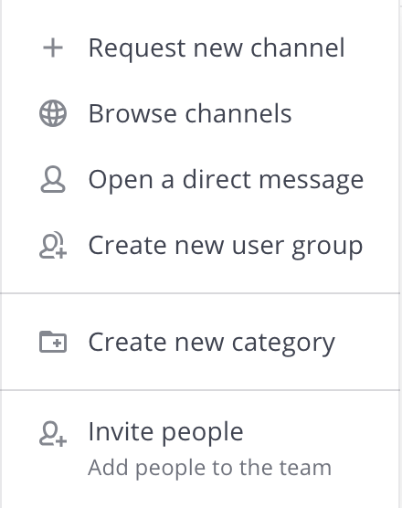
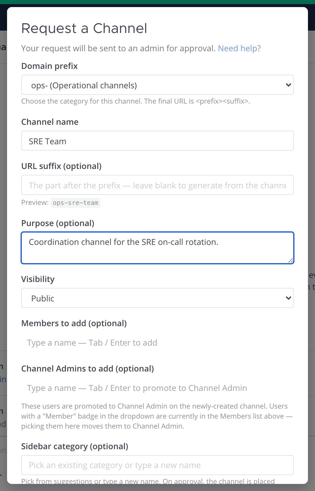
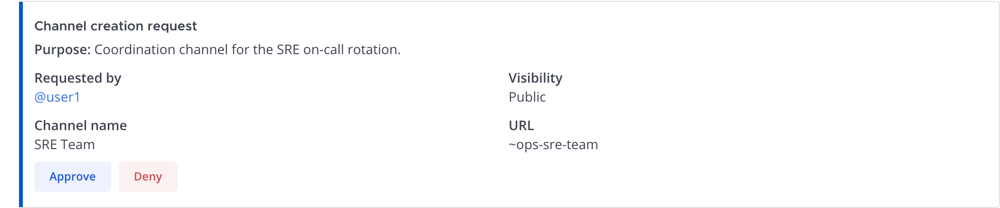
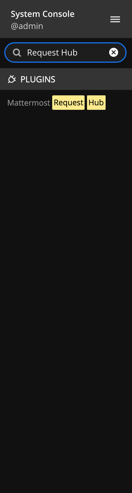
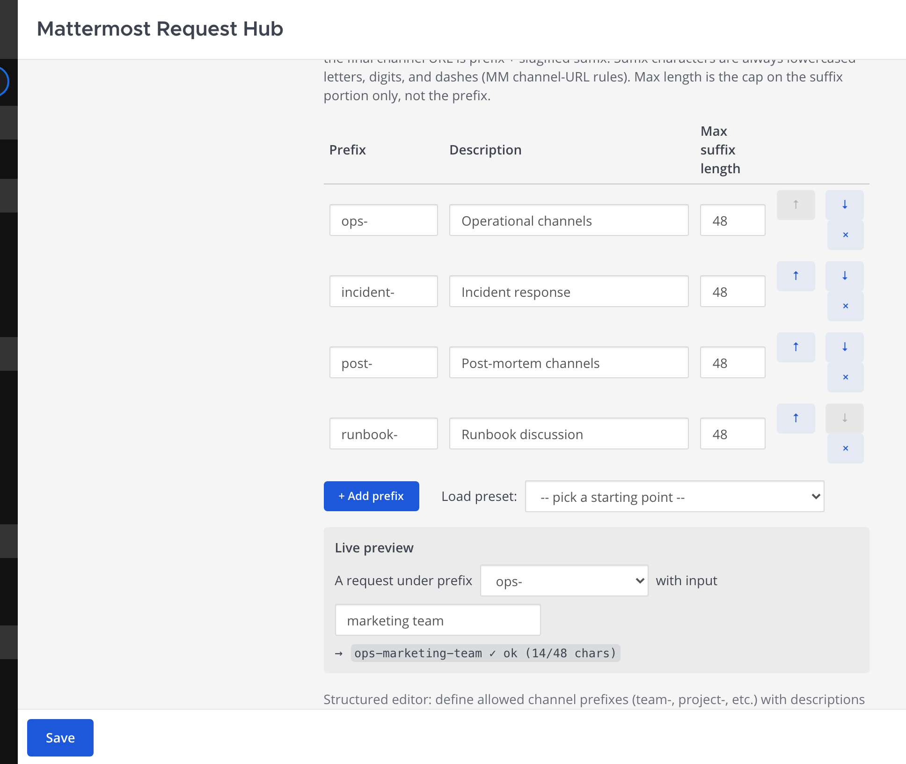

# Channel Requests — User Guide

Mattermost Request Hub lets members **request** a new channel instead of
creating one directly. The request goes to an approver; on approval the channel
is created, the requested members and Channel Admins are added, optionally placed
in a sidebar category, and everyone added gets an @-mention welcome message.

> Companion guides: [Channel Admin](CHANNEL_ADMIN_GUIDE.md) ·
> [teams](TEAM_REQUEST_GUIDE.md) · [bots](BOT_REQUEST_GUIDE.md) ·
> [webhooks](WEBHOOK_REQUEST_GUIDE.md) · [Admin Guide](admin-guide.md).
>
> In Mattermost, open the full in-app guide anytime with
> **`/mattermost-request-hub docs`**.

This guide covers:

- [Requesting a channel](#requesting-a-channel) — any member
- [Messaging while a request is pending](#messaging-while-a-request-is-pending) — two-way threads
- [Approving requests](#approving-requests) — approvers
- [Admin setup](#admin-setup) — system admins

---

## Requesting a channel

Same form from every entry point.

### How to open

- **+ menu:** channel sidebar **+** → **Request new channel** (native “Create new channel” is relabeled when members can’t create channels directly)
- **Hub:** right App Bar **plug** → Requests → **Request a Channel** (if several plugins share the strip, pick **Requests** first; with App Bar off, the same control is a channel-header plugin button)
- **Dropdown:** channel name → More actions → **Request a Channel**
- **Slash:** `/mattermost-request-hub channel`

> Tip: **`/mattermost-request-hub docs`** opens this documentation in a simple
> browser page (all request types in one place).

### Form

| Field | What it does |
|-------|--------------|
| **Domain prefix** | Appears only if your admin configured prefixes. Pick the category — the final URL is `<prefix><suffix>`. |
| **Channel name** | The display name people see (e.g. *SRE Team*). Required. |
| **URL suffix / URL name** | Optional. Leave blank to auto-generate from the channel name. A live **Preview** shows the final URL (e.g. `ops-sre-team`). |
| **Purpose** | Optional short description of the channel. |
| **Visibility** | **Public** (anyone can join) or **Private** (invite only). |
| **Members to add** | Search and add users who become regular members on approval. |
| **Channel Admins to add** | Search and add users who become Channel Admins on approval. |
| **Sidebar category** | Optional. Pick an existing category or type a new name. On approval the channel is placed there for you and listed members; a missing category is created automatically. |

**Members vs Channel Admins:** a user can be in only one of the two lists. If you
add someone to Channel Admins who's already a Member (or vice versa), they
**move** to the new list automatically — a badge in the dropdown shows where a
user is currently assigned.

Click **Submit request**. You'll see a confirmation, and you'll get a direct
message when an approver responds.

---

## Messaging while a request is pending

Every request opens a **linked pair of threads**: one on the approval card and
one in a DM from the bot. Replies are relayed both ways.

Use the **Thread** right-hand sidebar (open **Reply** on the card) — not a new
top-level channel or DM message.

- **Approver:** ask in the approval Thread (e.g. *Why do you need this channel?*)
- **Requester:** see `Message from @admin:` in your DM Thread with the bot
- **Reply:** answer in that DM Thread; the approval Thread shows `Reply from @you:`

Threads stay usable after approve/deny for follow-ups. Messaging the bot outside
a ticket thread gets a nudge to reply inside the specific request instead.

---

## Approving requests

Approvers (System Admins, the Team Admins of the team the channel is requested
in, plus Team Admins of the approval team if your admin enabled it) receive each
request in the **approval channel** with **Approve** and **Deny** buttons. Only a System Admin can approve a request they made
themselves. The card names the team the channel will be created in.

- **Approve** — creates the channel, adds the requested members, promotes the
  Channel Admins, places the channel in the requested sidebar category (if any),
  and posts a welcome message that @-mentions everyone added.
- **Deny** — the request is closed and the requester is notified by DM.

Requests from **System Admins** are queued for approval too. A System Admin can
approve their own request.

---

## Admin setup

Configure the plugin in **System Console → Plugins → Mattermost Request Hub**.

| Setting | Purpose |
|---------|---------|
| **Approval team** | The team that owns plugin-managed approval channels. Required. |
| **Allow channel requests** | Enables channel-creation entry points. |
| **Channel domain prefixes** | **Required.** The prefix list requesters pick from (see below). An empty list rejects every channel request. |
| **Team Admins can approve requests** | When on, Team Admins of the approval team can approve/deny channel-creation requests, not just System Admins. |
| **Per-team approval channels** | Default on. Creates `mattermost-channel-requests` in teams with a Team Admin or System Admin; those teams' channel requests go there (not the primary approval team). Ticket channels (including team-creation) live under sidebar category **Mattermost: Request Hub**. |

> To fully funnel non-admins through the request flow, remove the built-in
> **Create Public/Private Channel** permission from the System User role (System
> Console → User Management → Permissions). Mattermost's plugin API can't veto
> native channel creation.

### Domain prefixes

Each prefix is one row with a **prefix**, a **description**, and a **max suffix
length** (2–48 characters, capping the suffix only — not the prefix). A fresh
install starts empty:

Use **Load preset** to populate the table with a starter pack — **SRE / Ops**,
**Product org**, **Support / Success**, or **General org**. Loading a preset
updates prefixes you already have (description + max length) and appends any that
are missing. The **Live preview** at the bottom shows exactly what URL a request
will produce for a given prefix and typed suffix.

See also the [Admin Guide](admin-guide.md) and open **`/mattermost-request-hub docs`**
in Mattermost for the bundled HTML guide.
