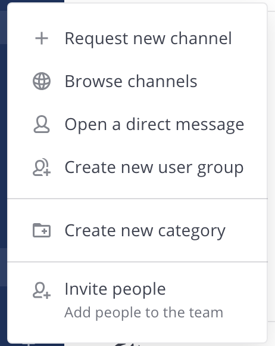
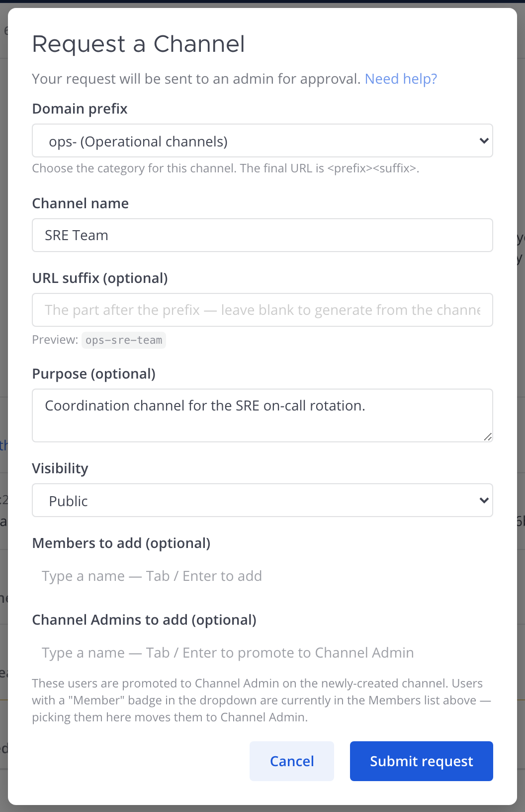
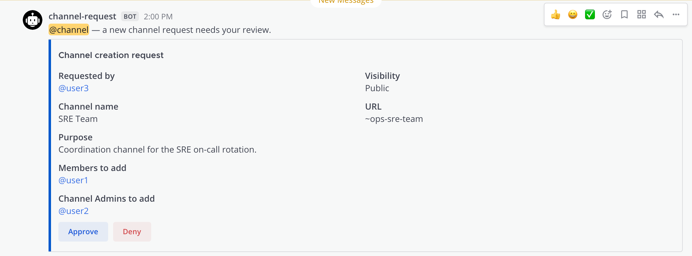
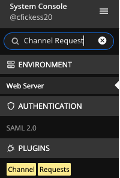
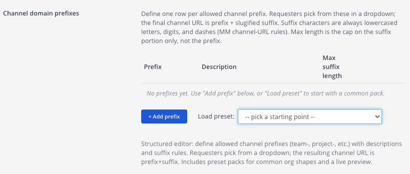
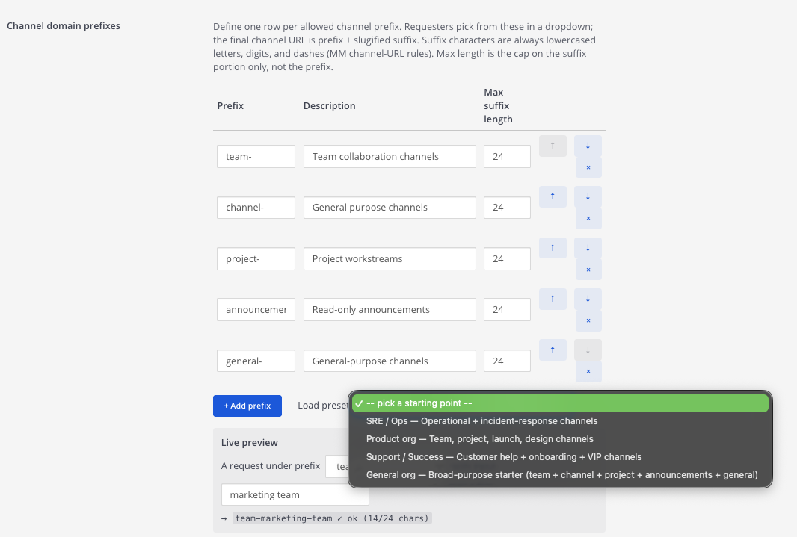

# Channel Requests — User Guide

The Channel Requests plugin lets members **request** a new channel instead of
creating one directly. The request goes to an approver; on approval the channel
is created, the requested members and Channel Admins are added, and everyone
added gets an @-mention welcome message.

> This is the companion to the [Channel Admin Requests guide](CHANNEL_ADMIN_GUIDE.md).
> *That* guide is about requesting **admin rights on an existing** channel; *this*
> one is about requesting a **brand-new** channel.

This guide covers three roles:

- [Requesting a channel](#requesting-a-channel) — any member
- [Approving requests](#approving-requests) — approvers
- [Admin setup](#admin-setup) — system admins

---

## Requesting a channel

There are a few ways to open the request form, and they all open the same
window.

### 1. From the "+" in the sidebar

Click the **+** at the top of the channel sidebar and choose **Request new
channel**. For members who can't create channels directly, Mattermost's native
"Create new channel" action is automatically relabeled to this.



### 2. From the channel header

Click the **Request Channel** icon in the channel header toolbar — same form as
the + menu.

### 3. From the slash command

Type `/channel-request` in any channel to open the request dialog. To request a
channel without the form, see
[Requesting from the command line](#requesting-from-the-command-line) below.

### Filling out the request



| Field | What it does |
|-------|--------------|
| **Domain prefix** | Required. Pick the category your admin configured — the final URL is `<prefix><suffix>`. |
| **Channel name** | The display name people see (e.g. *SRE Team*). Required. |
| **URL suffix / URL name** | Optional. Leave blank to auto-generate from the channel name. A live **Preview** shows the final URL (e.g. `ops-sre-team`). |
| **Purpose** | Optional short description of the channel. |
| **Visibility** | **Public** (anyone can join) or **Private** (invite only). |
| **Members to add** | Search and add users who become regular members on approval. |
| **Channel Admins to add** | Search and add users who become Channel Admins on approval. |

**Members vs Channel Admins:** a user can be in only one of the two lists. If you
add someone to Channel Admins who's already a Member (or vice versa), they
**move** to the new list automatically — a badge in the dropdown shows where a
user is currently assigned.

Click **Submit request**. You'll see a confirmation, and you'll get a direct
message when an approver responds.

**Limits.** A System Admin sets how many requests you can have waiting for
review at once (new channels and Channel Admins are counted separately). At the
limit you'll see *you have N pending requests waiting for review; you can submit
more once some are approved, denied or expire*. You can't have the same request
pending twice: asking again for a name you're already waiting on shows *you
already have a pending request for ~name in this team*. Requests that aren't
reviewed within the configured number of days expire, and you'll get a direct
message saying so.

Requests need at least one domain prefix. Until a System Admin defines one, the
form and the slash command show: *Channel requests aren't configured yet. Ask a
System Admin to define at least one channel prefix in System Console → Plugins →
Channel Requests.*

### Requesting from the command line

`/channel-request` on its own opens the request form. Add a subcommand to do the
same things from the message box. Replies are only visible to you.

| Command | What it does |
|---------|--------------|
| `/channel-request` | Opens the channel request form. |
| `/channel-request create <prefix> <Channel name> [options]` | Requests a channel in the current team without the form. Options are listed below. |
| `/channel-request admin @user [@user ...]` | Asks for those channel members to be made Channel Admins of the channel you run it in. See the [Channel Admin Requests guide](CHANNEL_ADMIN_GUIDE.md#3-from-the-slash-command). |
| `/channel-request prefixes` | Lists the channel prefixes you can use, with each one's description and suffix rule. |
| `/channel-request help` | Shows the usage message. |

For `create`, the prefix comes first, typed exactly as `/channel-request prefixes`
lists it (for example `team-`). Then comes the channel name, which can be several
words, then any options in any order. Each option takes the words up to the next
`--`.

| Option | What it does |
|--------|--------------|
| `--suffix <suffix>` | The URL part after the prefix, as one word. Leave it out to generate it from the channel name. |
| `--purpose <text>` | A short description of the channel. |
| `--private` | Makes the channel private. Without it the channel is public. |
| `--members @user ...` | Users who become regular members on approval. |
| `--admins @user ...` | Users who become Channel Admins on approval. |

For example:

```
/channel-request create team- Marketing Team --purpose Campaign planning --members @alice @bob --admins @carol
/channel-request create ops- SRE On-call --suffix sre-oncall --private
```

The request goes through the same approval as the form, and you get the same
confirmation. If something is wrong, such as an unknown prefix, an unknown
`@user` or a suffix that breaks the prefix's rule, the reply says what, and
nothing is submitted.

A channel name or purpose can't contain a word that starts with `--`, and extra
spaces or line breaks in the purpose become single spaces. Use the form if you
need either.

### Requesting through an AI agent

When a System Admin turns on **Offer tools to Agents**, an agent from the
Mattermost Agents plugin can file requests for you. Ask it in plain words, for
example "request a private channel called Marketing Team under `team-` and add
@alice". The agent acts as you, so the request follows the same rules as the
form: you must be a member of the team or channel, the prefix must be one your
admin configured, and the request goes to the approvers unless you are a System
Admin or on the auto-approve list.

| Tool | What it does |
|------|--------------|
| `list_prefixes` | Lists the channel prefixes you can use, like `/channel-request prefixes`. |
| `request_channel` | Requests a new channel, like the form or `/channel-request create`. |
| `request_channel_admin` | Asks for channel members to be made Channel Admins, like `/channel-request admin`. See the [Channel Admin Requests guide](CHANNEL_ADMIN_GUIDE.md#4-through-an-ai-agent). |

No agent can approve or deny a request.

---

## Approving requests

Approvers (System Admins, plus Team Admins of the approval team if your admin
enabled it) receive each request in the **approval channel** with **Approve**
and **Deny** buttons. Only a System Admin can approve a request they made
themselves. The card names the team the channel will be created in. A request
an AI agent filed for someone arrives the same way and names that person as the
requester; agents can't approve or deny.



- **Approve** — creates the channel, adds the requested members, promotes the
  Channel Admins, and posts a welcome message that @-mentions everyone added.
- **Deny** — the request is closed and the requester is notified by DM.

Approve checks the request again first. If the requester's account is no longer
active, they've left the team, or the channel name no longer matches the
configured prefixes, you'll get a private message saying so (for example *The
requester is no longer a member of the team. Deny this request instead.*). The
request stays pending and the card keeps its buttons, so deny it. If the
requester can't be checked at that moment, you'll see *Could not check the
requester right now. Try again in a moment.* instead.

A request that wasn't reviewed within **Request expiry (days)** can't be
approved: clicking either button replies *This request has expired.*, marks the
card *⌛ Expired: not reviewed within N days.* and DMs the requester.


Requests from users on the **auto-approve list** (and from System Admins) skip
this step — the channel is created immediately.

---

## Admin setup

Configure the plugin in **System Console → Plugins → Channel Requests** (search
"Channel Requests" to jump straight to it).



| Setting | Purpose |
|---------|---------|
| **Approval team** | The team whose channel receives requests. Recommended. |
| **Approval channel** | The channel where Approve/Deny cards are posted. Recommended: if it isn't set, or the channel is missing or archived, each request is sent by direct message to every System Admin instead. |
| **Channel domain prefixes** | The prefix list requesters pick from (see below). **At least one is required** — until one exists, requesters are told the plugin isn't configured and can't submit. |
| **Team Admins can approve requests** | When on, Team Admins of the approval team can approve/deny channel-creation requests, not just System Admins. |
| **Auto-approve requests from these users** | Requests from these users skip approval. |
| **Pending requests per user** | How many requests of each kind (new channel, Channel Admin) one user can have waiting for review, up to `1000`. Default `5`; `0` means no limit. |
| **Request expiry (days)** | Pending requests older than this can no longer be approved, and stop counting toward the per-user limit. At most `3650`. Default `30`; `0` means requests never expire. A change applies to requests already pending too. |
| **Audit channel ID** | Optional. Posts an audit line for every approve/deny. Must be an existing private channel; otherwise audit lines are skipped and a warning is logged. |
| **Offer tools to Agents** | Off by default. When on, the Mattermost Agents plugin can list prefixes and file channel and Channel Admin requests on a user's behalf, under the same rules as the slash command. Requests from System Admins and auto-approve users take effect at once. Agents can never approve or deny. Takes effect on save; choose which tools agents may use in the Agents plugin's own settings. |

> To fully funnel non-admins through the request flow, remove the built-in
> **Create Public/Private Channel** permission from the System User role (System
> Console → User Management → Permissions). Mattermost's plugin API can't veto
> native channel creation.

### Domain prefixes

Each prefix is one row with a **prefix**, a **description**, and a **max suffix
length** (2–32 characters, capping the suffix only — not the prefix). A fresh
install starts empty:



Use **Load preset** to populate the table with a starter pack — **SRE / Ops**,
**Product org**, **Support / Success**, or **General org**. Loading a preset
updates prefixes you already have (description + max length) and appends any that
are missing. The **Live preview** at the bottom shows exactly what URL a request
will produce for a given prefix and typed suffix.


