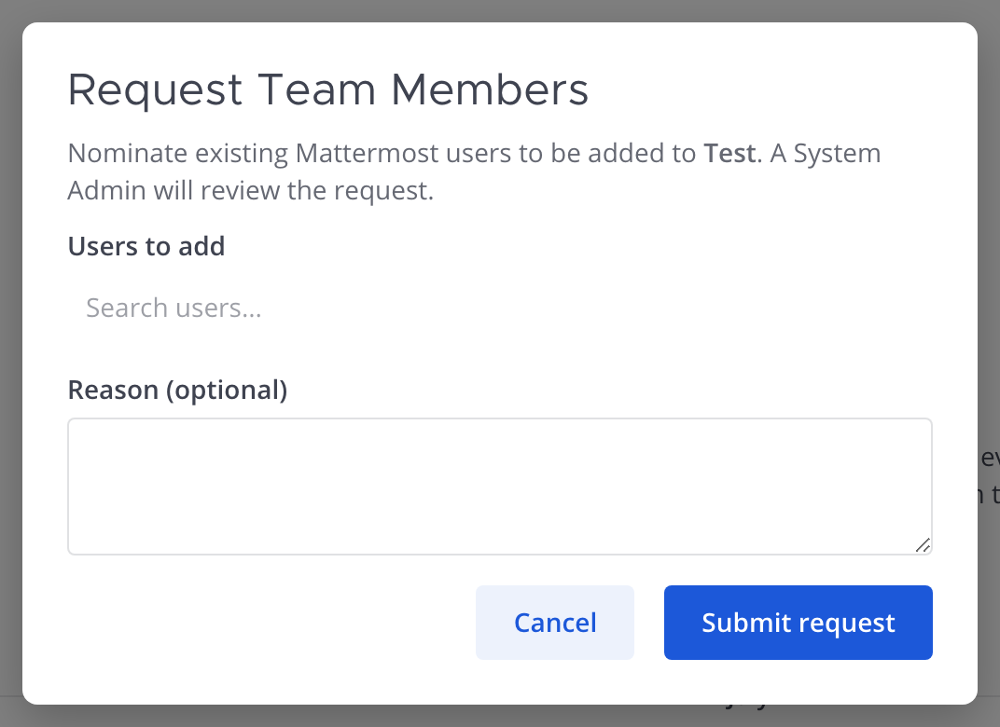
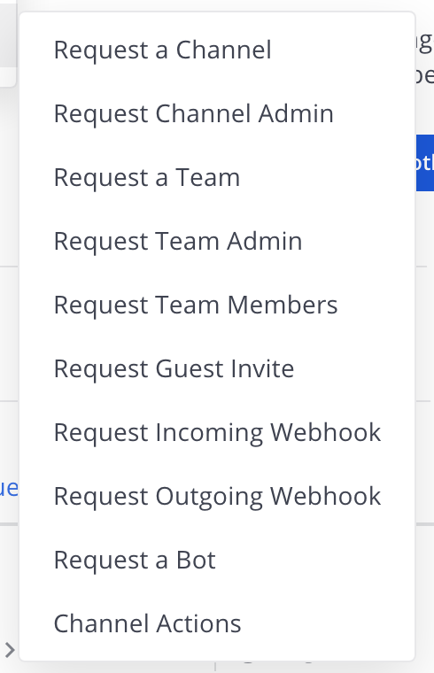
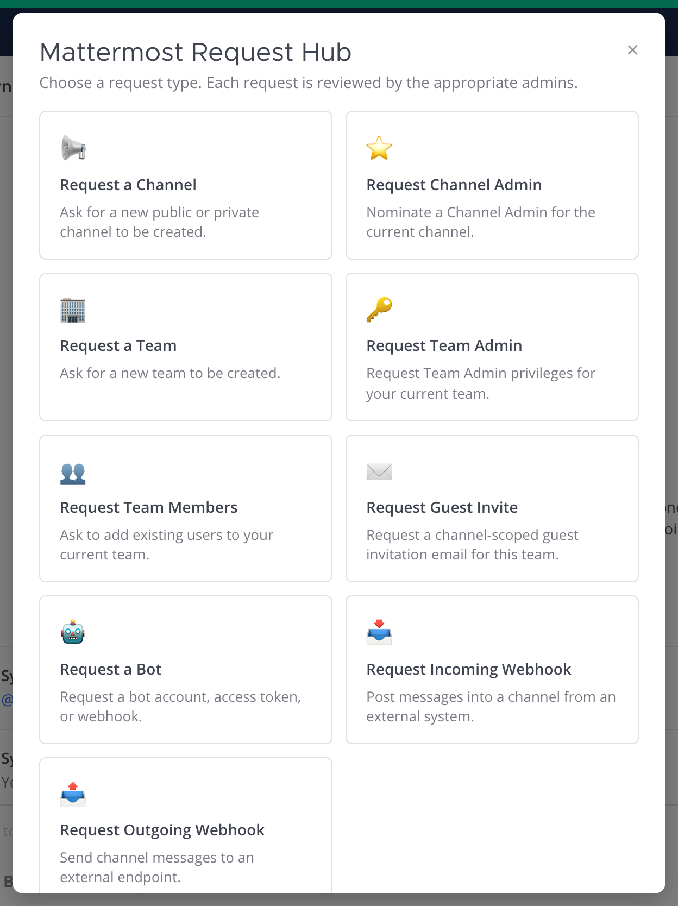
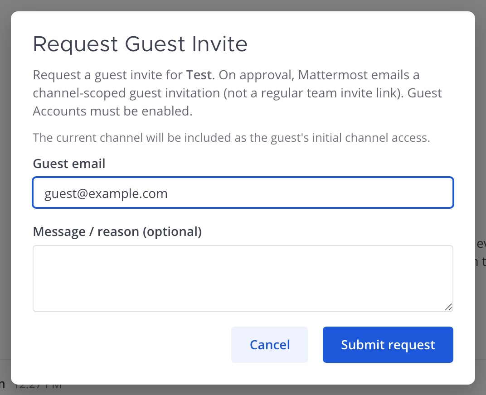
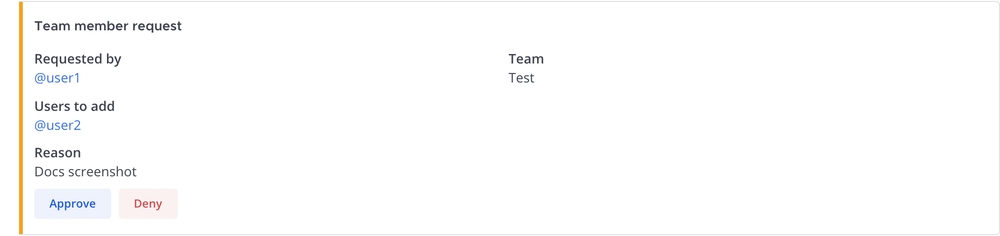
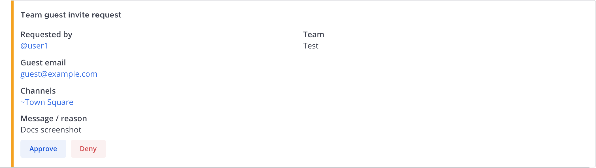

# Team Membership & Guest Invites — User Guide

Mattermost Request Hub lets members **request adding existing users to a team**
and **request a guest invite** for a team — without granting everyone the
permission to manage membership directly. Both ticket types route to the
plugin-managed **`mattermost-team-requests`** channel for System Admin approval.

> **Not the same as Team Admin.** [Request Team Admin](TEAM_REQUEST_GUIDE.md#requesting-team-admin)
> promotes someone to the Team Admin *role*. This guide is about **membership**:
> adding people to the team, or inviting an external guest.
>
> Companion guides: [new channels](CHANNEL_CREATION_GUIDE.md) ·
> [Channel Admin](CHANNEL_ADMIN_GUIDE.md) · [teams](TEAM_REQUEST_GUIDE.md) ·
> [bots](BOT_REQUEST_GUIDE.md) · [webhooks](WEBHOOK_REQUEST_GUIDE.md) ·
> [Admin Guide](admin-guide.md).
>
> In Mattermost, open the full in-app guide anytime with
> **`/mattermost-request-hub docs`**.

This guide covers:

- [Requesting team members](#requesting-team-members) — add existing users to a team
- [Requesting a guest invite](#requesting-a-guest-invite) — channel-scoped guest email
- [Messaging while a request is pending](#messaging-while-a-request-is-pending) — two-way threads
- [Approving requests](#approving-requests) — System Admins
- [Admin setup](#admin-setup) — system admins

---

## Requesting team members

Use this when you need **existing Mattermost users or bots added to a team**
(full membership). Any authenticated user can nominate people or bots onto a
team — you do **not** need to already be a member of that team. System Admin
approval is the access-control gate.

**Bots use the same process:** after the bot account exists (Request a Bot),
open **Request Team Members**, search for the bot username, and submit. Approvers
treat it like any other team-add ticket.

Hub tile label: **Request Team Members** — “Ask to add existing users or bots to
your current team.” If that tile is missing, turn on **Allow team member requests**
in System Console (see [Admin setup](#admin-setup)).

### How to open

- **Dropdown:** channel More actions → **Request Team Members**
- **Hub:** right App Bar **plug** → Requests → **Request Team Members**
- **Slash:** `/mattermost-request-hub team-member` (or skip the form with
  `/mattermost-request-hub team-member @user [@user ...] [--reason <text>]`)
- **Agent:** when **Offer tools to Agents** is on, ask an agent from the
  Mattermost Agents plugin to file it for you (the `request_team_member` tool; see the
  [admin guide](admin-guide.md#agents-tools))

### Form

The form targets the **team you are currently viewing**. Switch teams first if
you need a different one.

| Field | What it does |
|-------|--------------|
| **Users or bots to add** | Type a name — suggestions populate as you type (same picker as channel requests). Results are users **or bots** not already on this team. |
| **Reason** | Optional. Context for reviewers. |

Click **Submit request**. You'll get a DM when a System Admin responds.

---

## Requesting a guest invite

Use this when an **external person** should join as a **guest** with access to
specific channels — not as a regular team member. You must already be a
**member of the target team** (System Admins may invite for any team).

Guest Accounts must be enabled in System Console for the emailed invite to
succeed on approve.

Hub tile label: **Request Guest Invite**. Guest invites **default off** — enable
**Allow team guest requests** or the tile and menu items stay hidden.

### How to open

- **Dropdown:** channel More actions → **Request Guest Invite**
- **Hub:** right App Bar **plug** → Requests → **Request Guest Invite**
- **Slash:** `/mattermost-request-hub team-guest` (or skip the form with
  `/mattermost-request-hub team-guest <email> --channels ~channel [~channel ...] [--reason <text>]`)
- **Agent:** when **Offer tools to Agents** is on, ask an agent from the
  Mattermost Agents plugin to file it for you (the `request_team_guest` tool; see the
  [admin guide](admin-guide.md#agents-tools))

### Form

The form uses the **current team** and includes the **current channel** as the
guest's initial channel access. Switch to the right channel before opening the
form if needed.

| Field | What it does |
|-------|--------------|
| **Guest email** | **Required.** Address Mattermost will email a channel-scoped guest invitation to on approve. |
| **Message / reason** | Optional note for reviewers. |

Click **Submit request**. You'll get a DM when a System Admin responds.

> This flow does **not** return the team's regular invite link
> (`/signup_user_complete/?id=…`). That link grants ordinary membership, not
> guest access.

---

**Limits.** A System Admin sets how many team member requests and how many guest invite requests you can have waiting for review
at once (each request type is counted separately). At the limit you'll see *you
have N pending requests waiting for review; you can submit more once some are
approved, denied or expire*. Asking again for the same people in the same team shows *you already have a
pending request to add these people to this team*; asking again to invite the
same email address to the same team shows *you already have a pending request to
invite email to this team*. Requests that aren't reviewed within the configured number of days expire, and
you'll get a direct message saying so.

## Messaging while a request is pending

Team member and guest requests use the same **two-way Thread relay** as other
Request Hub tickets. Open the **Thread** RHS from the card (**Reply**) — don't
post a new top-level message.

- **Approver:** ask in the approval Thread
- **Requester:** see `Message from @admin:` in your DM Thread with the bot
- **Reply:** answer in that DM Thread; the approval Thread shows `Reply from @you:`

---

## Approving requests

Both request types post to **`mattermost-team-requests`**. Only **System Admins**
can Approve or Deny.

### Team members

- **Approve** — each nominee is added to the target team. The requester is
  notified by DM. Partial failures are listed in the outcome message.
- **Deny** — closes the request and notifies the requester by DM.

Approve first checks that the team still exists, isn't archived and isn't
managed by groups, and that the requester and every nominee are still active. If
not, you'll get a private message saying so and the request stays pending, so
deny it.

Requests from System Admins are queued for approval too.

### Guest invites

- **Approve** — Mattermost emails a **channel-scoped guest invitation** to the
  address on the ticket. The requester is notified by DM.
- **Deny** — closes the request and notifies the requester by DM.

Approve first checks that the team and each channel still exist and aren't
archived, that each channel is still in the team, and that the requester is still active, on the team and in each
channel (System Admins excepted). If not, you'll get a private message saying so
(for example *~town has been archived. Deny this request instead.*) and the
request stays pending, so deny it.

Requests from System Admins are queued for approval too.

---

## Admin setup

**System Console → Plugins → Mattermost Request Hub:**

| Setting | Purpose |
|---------|---------|
| **Approval team** | Team that owns plugin-managed approval channels (use the team **name**, e.g. `test`). Required. |
| **Allow team member requests** | Shows **Request Team Members** (add existing users). Default **on**. |
| **Allow team guest requests** | Shows **Request Guest Invite**. Default **off**. |

Also enable **Guest Accounts** before relying on emailed guest invites.

Both ticket types land in **`mattermost-team-requests`**. See the
[Admin Guide](admin-guide.md) for the full settings reference.
