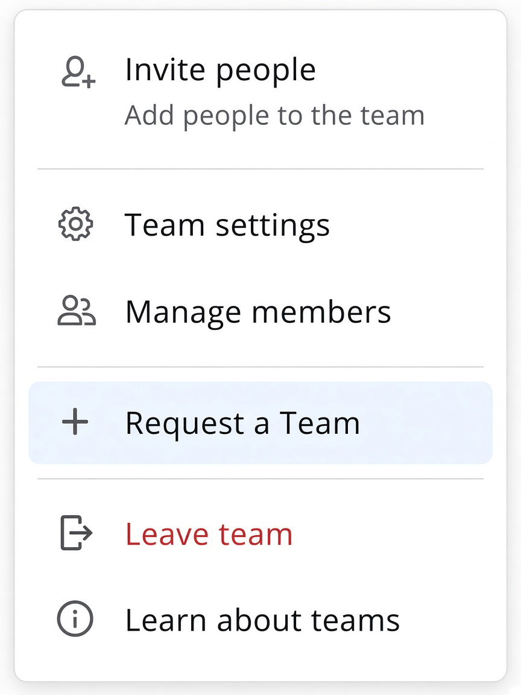
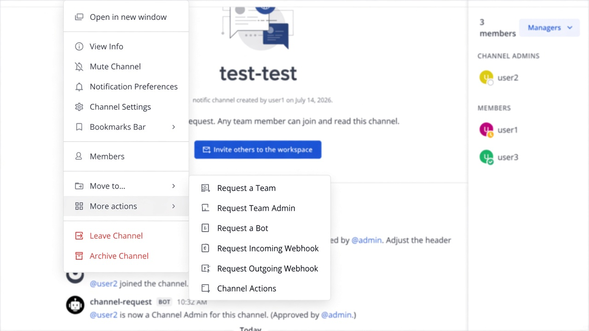
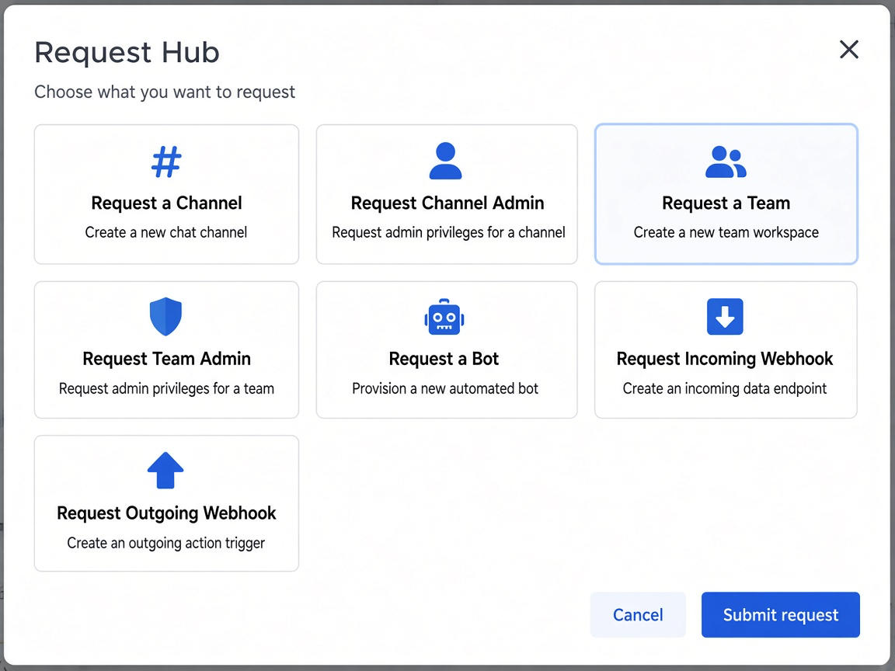
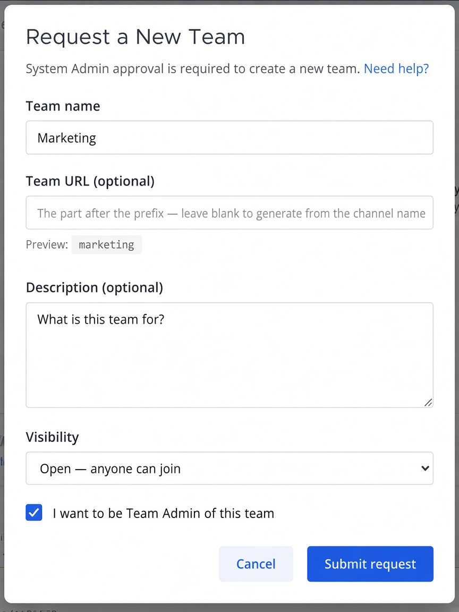
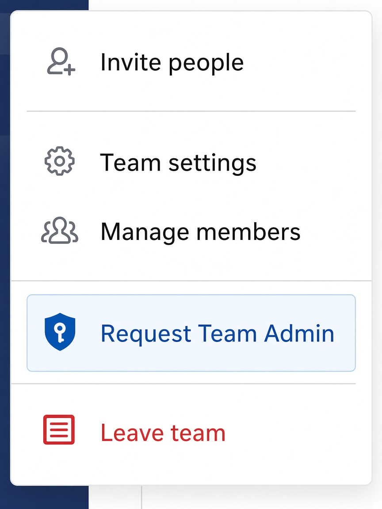
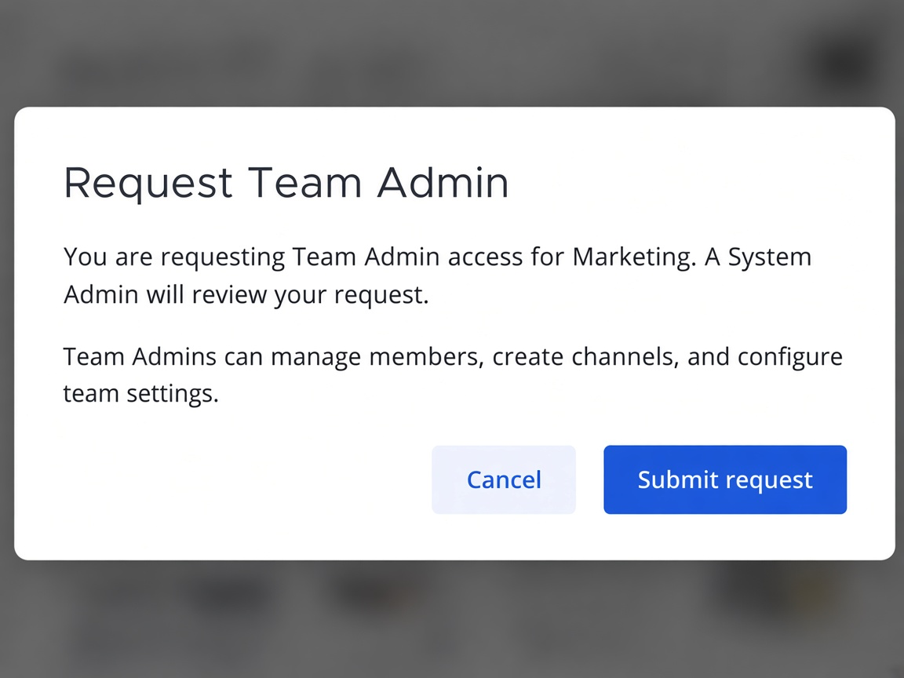
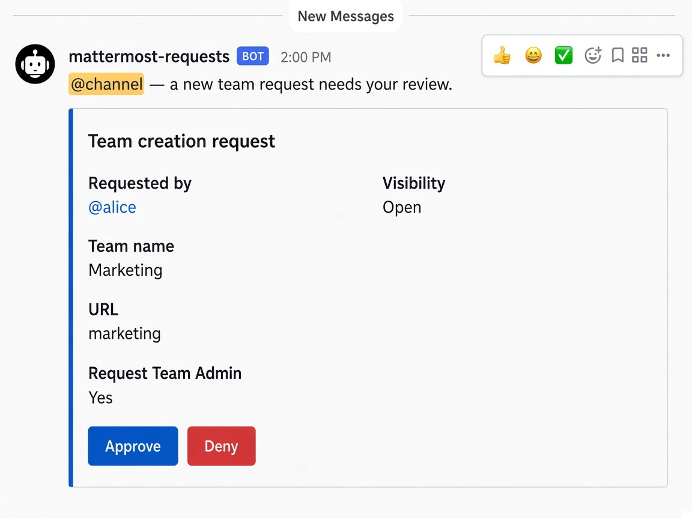
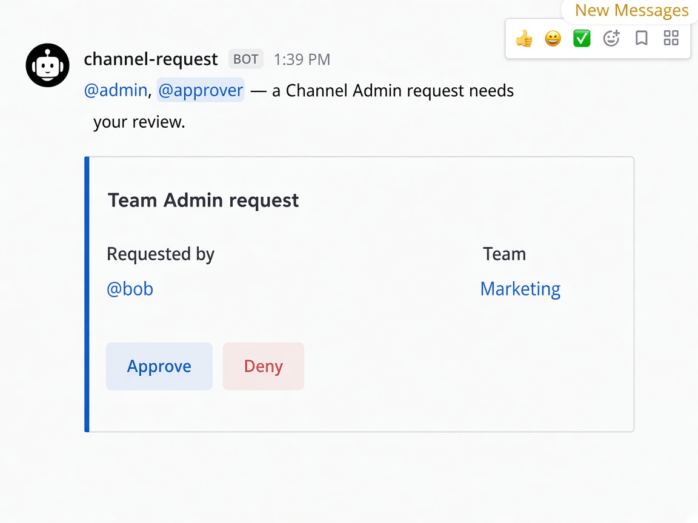

# Team Requests — User Guide

Mattermost Request Hub lets members **request a new team** (and, separately,
**request Team Admin** on a team they already belong to) instead of creating or
promoting themselves directly. Requests go to System Admins; on approval the team
is created (or the requester is promoted) and the requester is notified by DM.

> Companion guides: [new channels](CHANNEL_CREATION_GUIDE.md) ·
> [Channel Admin](CHANNEL_ADMIN_GUIDE.md) · [bots](BOT_REQUEST_GUIDE.md) ·
> [webhooks](WEBHOOK_REQUEST_GUIDE.md).
>
> In Mattermost: **`/mattermost-request-hub docs`** opens the full HTML guide.

This guide covers:

- [Requesting a new team](#requesting-a-new-team) — any member
- [Requesting Team Admin](#requesting-team-admin) — members who are not already Team Admin
- [Messaging while a request is pending](#messaging-while-a-request-is-pending) — two-way threads
- [Approving requests](#approving-requests) — System Admins
- [Admin setup](#admin-setup) — system admins

---

## Requesting a new team

There are several ways to open the same **Request a New Team** form. Use
whichever is handiest — the form is identical either way.

### 1. Native: team sidebar menu

Click your **team name** (or the team switcher) in the left sidebar. For members
who can't create teams directly, Mattermost's native **Create a team** action is
relabeled to **Request a Team** and opens the request form instead of the native
create flow.

System Admins still see the native **Create a team** flow unchanged.

### 1b. Team rail **+** button

On the far-left team strip, the **+** under your teams opens native
**Create a Team** when you have permission. Non–System Admins are redirected to
the same **Request a Team** form (when **Allow team requests** is on). The
**Other teams you can join** (+) path is left unchanged.

### 2. Dropdown: channel More actions

Click the **channel name** at the top-left of the center pane, then
**More actions → Request a Team**.

### 3. Right-side plug icon (Requests hub)

On the **far right** of the Mattermost window (the App Bar / plugin strip), click
the **plug** icon. That opens the plugin's **Requests** entry (tooltip:
*Open the request hub…*). In the **Request Hub**, choose **Request a Team**.

If several plugins share the strip, the plug may open a short menu first —
pick **Requests**, then the hub tile.

### Filling out the request

| Field | What it does |
|-------|--------------|
| **Team name** | Display name people see (e.g. *Marketing*). Required. |
| **Team URL** | Optional. Leave blank to auto-generate from the team name. A live **Preview** shows the final URL. |
| **Description** | Optional short description of the team's purpose. |
| **Visibility** | **Open** (anyone can join) or **Invite-only** (members must be invited). |
| **I want to be Team Admin of this team** | Optional. When checked, approval also promotes you to Team Admin on the new team. |

Click **Submit request**. You'll see a confirmation, and you'll get a direct
message when a System Admin responds.

---

## Requesting Team Admin

Use this when you already belong to a team and need Team Admin rights (manage
members, create channels, configure team settings). The option is **hidden if
you're already a Team Admin or System Admin** for that team.

### 1. Native: team sidebar menu

Open the **team sidebar** menu. Below **Manage members** / **View members** you'll
see **Request Team Admin**.

### 2. Dropdown: channel More actions

Click the **channel name**, then **More actions → Request Team Admin**.

### 3. Right-side plug icon (Requests hub)

Click the **plug** icon on the right App Bar → **Requests** → **Request Team
Admin** (hidden if you already hold the role). Same hub as for a new team —
see the plug-icon screenshot above.

### Confirming the request

The form confirms which team you're requesting admin on. Click **Submit request**.
You'll get a DM when a System Admin responds.

---

## Messaging while a request is pending

Every request opens a **linked pair of threads**: one in the approval channel
(for reviewers) and one in a DM from the bot (for you). Replies are relayed both
ways, so reviewers can ask questions without giving you access to the approval
channel — and you can answer without leaving your DMs.

**Example — new team request**

Use Mattermost's **Thread** panel (right-hand sidebar) — not a new top-level
message in the channel or DM list. Open the thread from the request card
("Reply" / reply count), then type in **Reply to thread…**.

1. A System Admin opens the **Thread** on the approval card and asks why you
   need the team:

2. That reply shows up in **your DM Thread** with the bot, prefixed
   `Message from @admin:`:

3. You **reply in that same Thread** (Reply to thread… — not a new root DM).
   Your answer is posted back into the approval Thread as
   `Reply from @you:`:

The same pattern works for **Team Admin** requests (and every other request
type). Threads stay open after approve/deny so you can still follow up.

> Tip: If you message the bot outside a ticket thread, it nudges you to reply
> inside the specific request thread instead.

---

## Approving requests

### New team

Team creation requests post to the plugin-managed
**`mattermost-team-requests`** private channel in the approval team.
System Admins see **Approve** and **Deny**.

- **Approve** — creates the team, adds the requester, and (if they checked the
  box) promotes them to Team Admin. The requester is notified by DM.
- **Deny** — closes the request and notifies the requester by DM.

System Admins who submit a team request themselves bypass the queue — the team
is created immediately.

### Team Admin

Team Admin requests post to the **root approval channel** (same channel as
channel / Channel Admin requests). System Admins Approve or Deny.

- **Approve** — promotes the requester to Team Admin on that team and notifies them by DM.
- **Deny** — closes the request and notifies the requester by DM.

---

## Admin setup

Configure the plugin in **System Console → Plugins → Channel Requests** (or
**Mattermost Request Hub**, depending on your install name).

| Setting | Purpose |
|---------|---------|
| **Approval team** | Team that owns plugin-managed approval channels. Required. |
| **Allow team requests** | Enables **Request a Team** entry points. Default **off**. |
| **Allow team admin requests** | Enables **Request Team Admin** entry points. Default **off**. |

Team creation cards always go to **`mattermost-team-requests`**. Team Admin
cards go to the configured root approval channel. See the
[Admin Guide](admin-guide.md) for the full settings reference.

> To fully funnel non-admins through the request flow, remove the built-in
> **Create Team** permission from roles that shouldn't create teams natively
> (System Console → User Management → Permissions). The plugin relabels the UI
> for non-admins, but it cannot veto the native create-team API.
