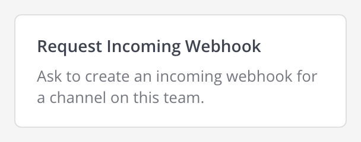
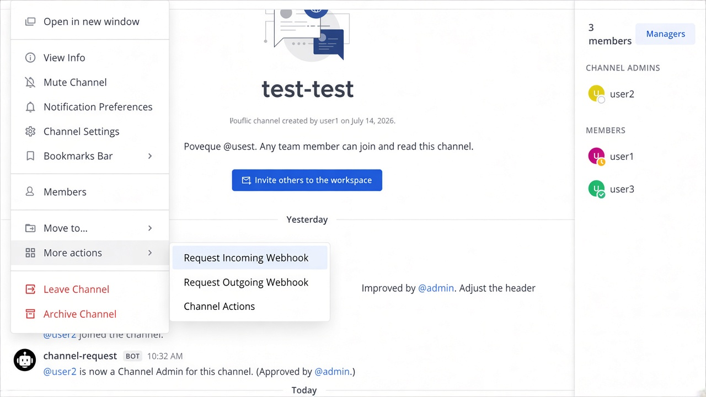
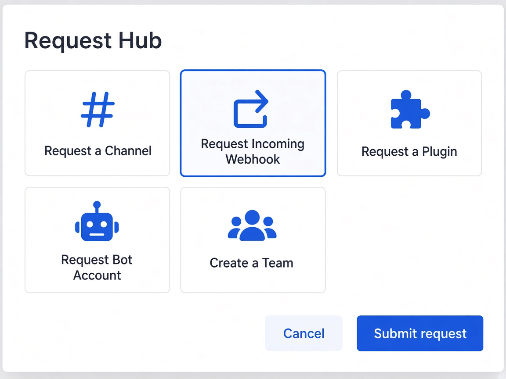
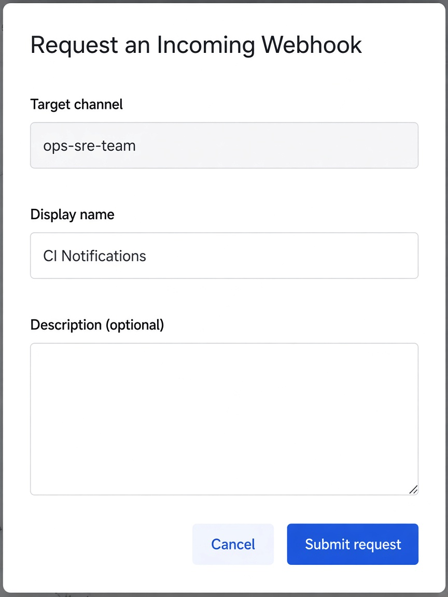
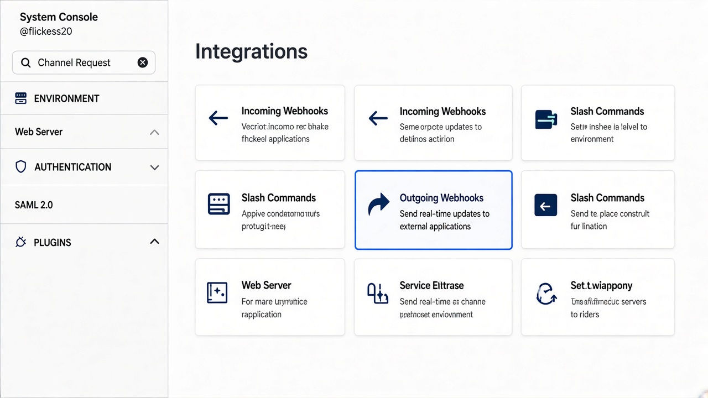
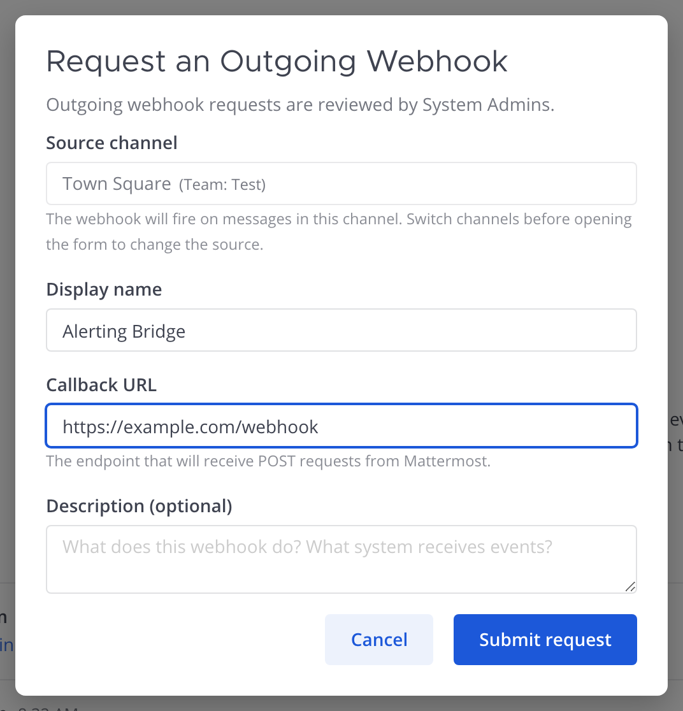
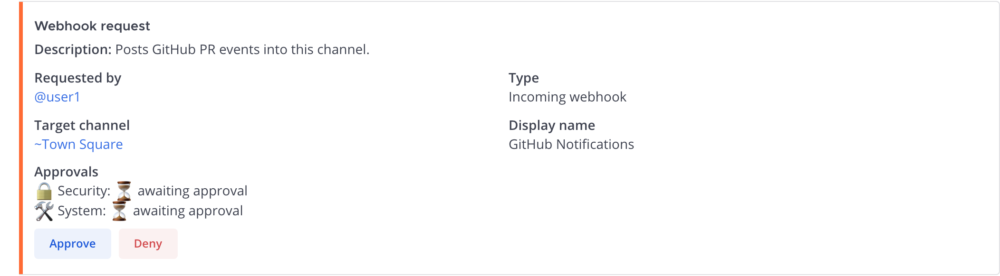
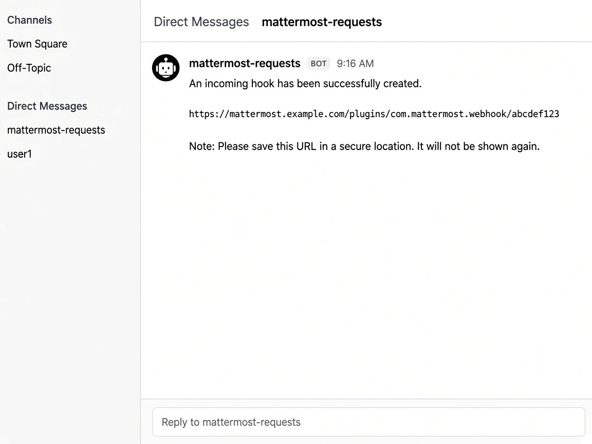

# Webhook Requests: User Guide

Use this guide when you need an **incoming** or **outgoing webhook** but don't
need a new bot account. Standalone webhook requests use **two-step approval**
(security + system). Secrets are delivered by DM.

> Setting up a full integration (bot + token + webhooks) in one ticket? Use the
> [bot account guide](BOT_REQUEST_GUIDE.md) instead.
>
> Companion guides: [new channels](CHANNEL_CREATION_GUIDE.md) ·
> [Channel Admin](CHANNEL_ADMIN_GUIDE.md) · [teams](TEAM_REQUEST_GUIDE.md) ·
> [bots](BOT_REQUEST_GUIDE.md).
>
> In Mattermost: **`/mattermost-request-hub docs`** opens the full HTML guide.

**Incoming webhook**: an external system POSTs messages into a Mattermost
channel. You get a URL to call.

**Outgoing webhook**: Mattermost forwards messages from a channel to your
external URL (useful for keyword-triggered pipelines).

This guide covers:

- [Requesting a webhook](#requesting-a-webhook): any member
- [Messaging while a request is pending](#messaging-while-a-request-is-pending): two-way threads
- [Approving requests](#approving-requests): security + system approvers
- [Admin setup](#admin-setup): system admins

---

## Requesting a webhook

Webhook menu items appear only in **public and private channels**, not in DMs
or group messages (those can't be webhook targets).

### How to open

- **Native:** Main Menu → Integrations → **Incoming** or **Outgoing Webhooks** (non–System Admins)
- **Dropdown:** channel More actions → **Request Incoming/Outgoing Webhook**
- **Hub:** right App Bar **plug** → Requests → the webhook tile
- **Slash:** `/mattermost-request-hub webhook-incoming` or `webhook-outgoing` (or skip the form with
  `webhook-incoming ~channel <Display name> [--description <text>]` or
  `webhook-outgoing ~channel <Display name> --callback <url> [--description <text>]`)
- **Agent:** when **Offer tools to Agents** is on, ask an agent from the
  Mattermost Agents plugin to file it for you (the `request_webhook` tool; see the
  [admin guide](admin-guide.md#agents-tools))

### Incoming webhook: form

| Field | What it does |
|-------|--------------|
| **Target channel** | Pre-filled with your current channel (read-only). Navigate to the intended channel before opening the form. |
| **Display name** | Label shown on the Integrations page. |
| **Description** | Optional. What system posts here and why. |

### Outgoing webhook: form

| Field | What it does |
|-------|--------------|
| **Source channel** | Pre-filled with your current channel (read-only). Must be a public channel: Mattermost runs outgoing webhooks only on public channels. |
| **Display name** | Label shown on the Integrations page. |
| **Callback URL** | Required. The `https://` (or `http://`) endpoint Mattermost will POST to. |
| **Description** | Optional. |

### After submitting

Click **Submit request**. You'll get a DM confirming the request was received,
then another when both approvers have acted.

---

## Messaging while a request is pending

Webhook tickets use the same **two-way thread relay**. Open the **Thread** RHS
from the card, not a new top-level channel or DM message.

- **Approver:** ask in the approval Thread
- **Requester:** see `Message from @admin:` in your DM Thread with the bot
- **Reply:** answer in that DM Thread; the approval Thread shows `Reply from @you:`

Always reply inside the ticket DM Thread, not a new root message to the bot.
Threads stay open after approve/deny for follow-ups.

---

## Approving requests

All standalone webhook requests post to
**`mattermost-webhook-requests`**. They use **two-step approval** (security +
system, two different people). The card shows both status lines.

When both steps are filled, the final approval creates the webhook. On success
the requester gets a DM with:

- The **webhook URL** (incoming)
- Confirmation that the outgoing webhook is live (outgoing)

If an incoming webhook URL can't be delivered to the requester, the hook is
**deleted automatically** so no unowned secret endpoint is left live.

**Deny** closes the ticket and notifies the requester by DM.

### System Admin note

Requests from System Admins are queued like any other. Nobody can approve
either step of their own request, so a System Admin's request needs a security
approver and a different system approver (or one other System Admin when the
approver mode is System Admins only).

If webhook creation fails after both steps, the card stays pending with an error
so the final approver can retry.

---

## Admin setup

| Setting | Purpose |
|---------|---------|
| **Approval team** | Owns `mattermost-webhook-requests`. Required. |
| **Allow webhook requests** | Enables incoming/outgoing entry points. Default **on**. |
| **Security / System approver attributes** | Same two-step attributes as bot requests. |

See the [Admin Guide](admin-guide.md) for attribute setup and the full settings
reference.
